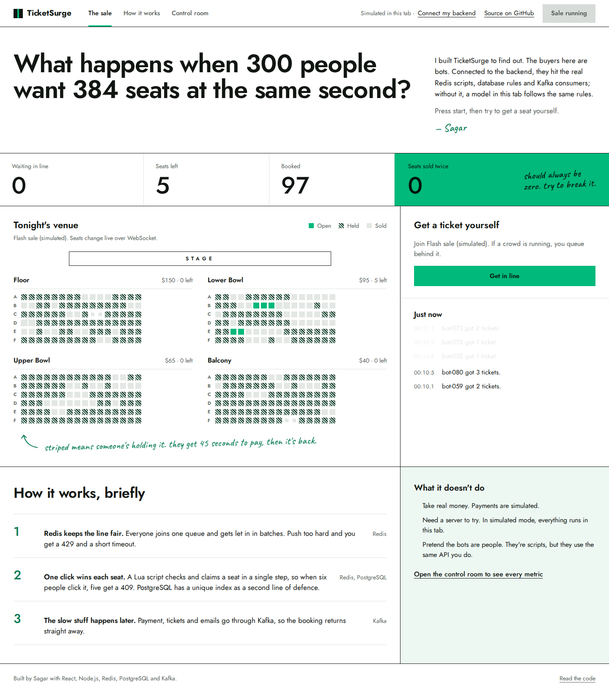

# TicketSurge Web

A live demonstration site for [TicketSurge](https://github.com/DevAndroidify/ticketsurge), a
flash-sale ticketing backend built with Kafka, Redis and PostgreSQL.

**Try it: [ticketsurge-web.vercel.app](https://ticketsurge-web.vercel.app)**. No setup: it runs a
simulation of the backend in your browser.

Send a crowd of virtual buyers at a sale, then turn the traffic up while it runs. They queue, hold
seats, lose races, retry, book and pay through the real API. Buy a ticket yourself in the middle of
it and watch your own request travel through the architecture, step by step. The site also shows
which services are up, requests per second, the seat map filling over WebSocket, Kafka lag building
and draining, and a live check that no seat is ever sold twice.



## Run it

```bash
nvm use
npm install
npm run dev        # http://localhost:5173
```

With the TicketSurge backend running, the dashboard connects to it (**live** mode). Without one it
runs an in-browser model of the backend (**simulated** mode), so it also works as a static site.
On the hosted site, **Connect my backend** links the page to a backend you run on your own machine.

## Deployment

The site is on Vercel, connected to this repository: every push to `main` deploys to
production, and every pull request gets a preview URL. Vercel builds with `npm run build` into
`dist/` on Node 24, with no environment variables. GitHub Actions runs lint, tests and the build on
each push and pull request (`.github/workflows/ci.yml`).

More detail: [docs/demo.md](docs/demo.md).

Built with React, TypeScript, Vite, Tailwind CSS and Motion.
